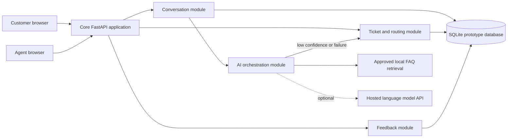

# Group G-2 Alpha architecture and integration trace

This implementation is a smaller, working vertical slice of the Unit 3 design, rather than evidence that the production-scalable design is complete.

## Trace A: answer from approved content

1. Customer opens a conversation and sends a new UUID-identified message.
2. Core validates the actor, conversation ownership, length and idempotency key.
3. The chatbot retrieves the closest approved FAQ entry; unmatched queries are escalated.
4. If optional model paraphrasing is enabled, the AI module sends only the question and approved FAQ answer (with illustrative PII redaction); provider errors result in escalation.
5. The conversation module persists the customer message and answer, and returns the approved source ID.
6. Customer can submit helpful/not-helpful feedback. The feedback enters a queue for **manual** review; it does not retrain a model.

## Trace B: human escalation

1. Customer explicitly requests an agent or asks an unsupported question.
2. Core persists original message and a queued ticket associated with the source message.
3. Agent opens the ticket queue, claims a ticket with optimistic version check.
4. Agent posts a reply to the same conversation. Customer can retrieve reply in message history.

## Boundaries

- `knowledge.py`: reference data and lexical-retrieval score; no ticket writes.
- `ai.py`: response decision and optional model provider; no DB access.
- `db.py`: DDL and SQLite connection adapter; no chatbot behavior.
- `main.py`: API validation and orchestration, owns messages/tickets/feedback with local database persistence. Future refinement should split routes by domain.
- `static/index.html`: local demo UI, no direct DB access.

**Important divergence:** Unit 3 called for PostgreSQL, Redis, OIDC/JWT, async events, SSE and separate AI deployment; none is implemented here. This is documented technical debt and an integration plan, not an assertion those features exist.
